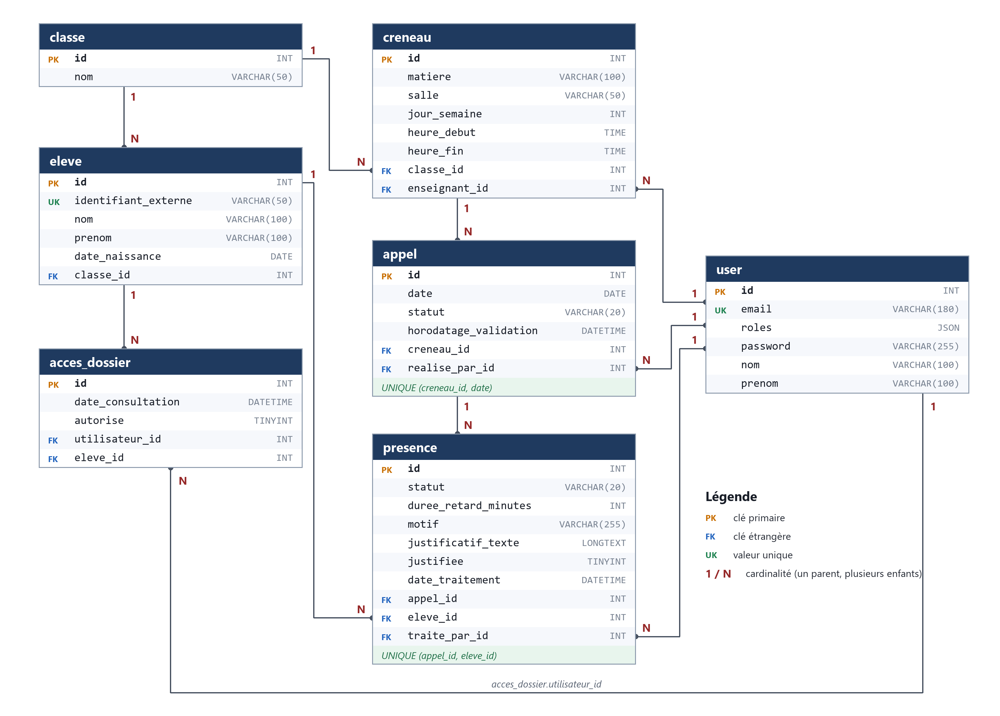

# Modèle de données : Assiduo v1

Base MariaDB 11.4. Le schéma ci-dessous est le modèle relationnel des 7 tables de
l'application, tel que créé par les migrations Doctrine (types, clés et contraintes réels).

## Le point délicat : créneau vs appel

Un **créneau** est un gabarit hebdomadaire récurrent (ex. « 4°B, mathématiques, tous les
mardis 10h-11h, salle 12, avec M. Duval »). Il ne porte aucune donnée de présence.

Un **appel** est une occurrence datée d'un créneau (ex. « le créneau du mardi 10h-11h, pour la
date du 15 septembre 2026 »). C'est l'appel qui porte les présences des élèves, son horodatage
de validation et son verrouillage. Un même créneau donne lieu à un appel distinct chaque
semaine, créé à la demande (l'enseignant ouvre son créneau du jour, l'appel est créé s'il
n'existe pas encore pour cette date).

Modéliser l'appel comme un simple attribut du créneau condamnerait l'application dès la
deuxième semaine de données (annexe technique §3.1). D'où la contrainte d'unicité
`(creneau_id, date)` portée par `appel`.

Types retenus (annexe §3.2) : `DATE` pour le jour de l'appel, `TIME` pour les heures du
créneau, entier pour le jour de la semaine. Rien n'est stocké en `DATETIME` quand une date ou
une heure suffit.

## Tables

### user
Compte de connexion, commun aux quatre rôles.
- `id`, `email` (unique), `password` (haché), `nom`, `prenom`
- `roles` (JSON) : `ROLE_ENSEIGNANT`, `ROLE_VIE_SCOLAIRE`, `ROLE_DIRECTION`, `ROLE_ADMIN`

### classe
- `id`, `nom` (ex. « 4°B »)

### eleve
- `id`, `identifiant_externe` (unique) : clé métier stable de l'établissement, utilisée pour
  rendre l'import CSV idempotent (annexe §4). Ce n'est jamais l'auto-incrément qui sert de clé
  de rapprochement.
- `nom`, `prenom`, `date_naissance` (`DATE`, nullable)
- `classe_id` → classe

### creneau (gabarit hebdomadaire)
- `id`, `matiere`, `salle`, `jour_semaine` (1 = lundi ... 7 = dimanche)
- `heure_debut`, `heure_fin` (`TIME`)
- `classe_id` → classe, `enseignant_id` → user

### appel (occurrence datée d'un créneau)
- `id`, `date` (`DATE`), `statut` (`ouvert` ou `verrouille`), `horodatage_validation` (nullable)
- `creneau_id` → creneau, `realise_par_id` → user (nullable tant que l'appel n'est pas fait)
- contrainte d'unicité : `(creneau_id, date)`

### presence (une ligne par élève par appel)
- `id`, `statut` (`present`, `absent`, `retard` ou `exclu`), `duree_retard_minutes` (nullable)
- `motif`, `justificatif_texte` (nullables)
- `justifiee` (booléen nullable) : `true` = justifiée, `false` = injustifiée, `null` = non
  encore traitée. Il n'y a pas de colonne « qualification » séparée qui pourrait se
  désynchroniser : l'état « non traité » est simplement celui d'une absence dont `motif`,
  `justificatif_texte`, `traite_par_id` et `date_traitement` sont encore vides (annexe §3.2).
  C'est ce qui alimente la file de traitement de la vie scolaire (F3).
- `traite_par_id` → user (nullable), `date_traitement` (nullable)
- `appel_id` → appel, `eleve_id` → eleve
- contrainte d'unicité : `(appel_id, eleve_id)`

### acces_dossier (RGPD, F5)
Trace chaque consultation du dossier d'un élève, y compris les tentatives refusées (scénario
de recette : un enseignant qui tente d'accéder à une autre classe). Alimentée par un service
explicite, plus un canal Monolog dédié (`acces_dossier`, voir `config/packages/monolog.yaml`)
qui écrit dans un fichier séparé (annexe §8).
- `id`, `date_consultation`, `autorise` (booléen)
- `utilisateur_id` → user, `eleve_id` → eleve

## Écarts assumés par rapport au schéma illustratif de l'annexe

Pas d'entité `Etablissement` ni d'entité `Enseignant` séparée de `User`. Voir
[dossier-architecture.md](dossier-architecture.md#écarts-assumés-par-rapport-au-schéma-illustratif-de-lannexe-31).

## Ce qui n'est volontairement pas modélisé (hors périmètre v1, brief §4.2)
- Espace responsable légal et dépôt de justificatif par un tiers
- Notifications par courriel
- Statistiques avancées et seuils de décrochage
- Purge automatique (la suppression sur demande de F5 reste une action manuelle déclenchée par
  l'administrateur)
